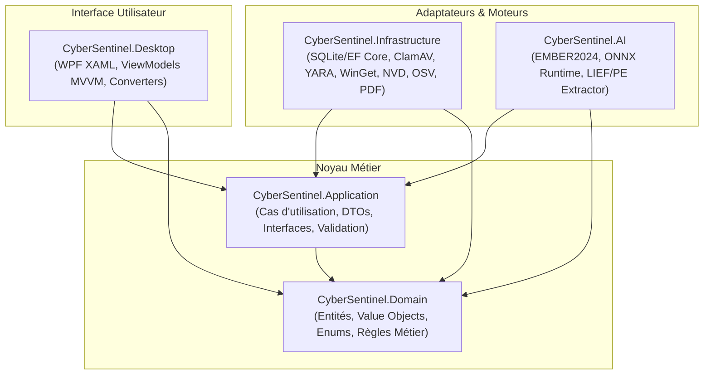
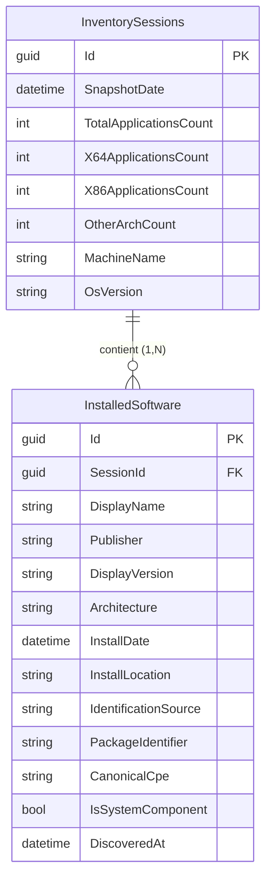

# Documentation Technique — CyberSentinel AI

> **Projet** : CyberSentinel AI  
> **Plateforme** : Windows 10 / 11 (x64)  
> **Framework cible** : .NET 10.0 LTS (C# 14)  
> **Architecture** : Clean Architecture en oignon, MVVM, SSDLC (Secure Software Development Life Cycle)  
> **Date de référence** : Novembre 2026  

---

## 1. Introduction et Périmètre du Système

**CyberSentinel AI** est une solution modulaire et unifiée de sécurisation du poste de travail (Endpoint Security & Vulnerability Management). Elle conjugue l'analyse locale des menaces de bas niveau (moteurs de signatures statiques et modèles d'apprentissage automatique de pointe) et la gestion continue du cycle de vie des vulnérabilités applicatives du système d'exploitation Windows.

La solution a été conçue pour fonctionner avec un niveau d'isolation maximal, éliminant toute dépendance tierce superflue au niveau des bibliothèques de production, et implémentant une résilience complète en environnement déconnecté (*air-gapped*).

---

## 2. Architecture Globale du Système

### 2.1 Clean Architecture (Architecture en Oignon)

CyberSentinel AI respecte rigoureusement les principes de la **Clean Architecture** théorisée par Robert C. Martin. La règle de dépendance est strictement unidirectionnelle : les cercles concentriques internes ignorent totalement l'existence des cercles externes.



### 2.2 Principes de Conception SOLID Appliqués

1. **Single Responsibility Principle (SRP)** :
   - Chaque composant dispose d'une responsabilité unique et bien délimitée. Par exemple, `PathSecurityValidator` ne s'occupe que de la validation et de la canonisation des chemins Windows ; `VerdictArbitrator` concentre exclusivement le calcul pondéré du score de menace.
2. **Open/Closed Principle (OCP)** :
   - L'ajout d'un nouveau moteur d'analyse (ex: moteur heuristique mémoire ou fournisseur de vulnérabilités supplémentaire) se fait par implémentation des interfaces `IAntivirusScanner` ou `IVulnerabilityProvider` sans modification de l'orchestrateur.
3. **Liskov Substitution Principle (LSP)** :
   - Les implémentations mock (`MockInventoryRepo`, `MockVulnerabilityScannerService`) et réelles (`SqliteInventoryRepository`, `NvdVulnerabilityProvider`) sont interchangeables sans altérer le comportement des tests ou de l'application.
4. **Interface Segregation Principle (ISP)** :
   - Des interfaces granulaires et ciblées (`IAiMalwareClassifier`, `ISecurityLogger`, `IQuarantineService`, `IPdfGenerator`) empêchent les clients de dépendre de méthodes superflues.
5. **Dependency Inversion Principle (DIP)** :
   - Les modules applicatifs de haut niveau dépendent exclusivement d'abstractions (définies dans `CyberSentinel.Application.Common.Interfaces`). L'injection de dépendances est centralisée dans la couche d'infrastructure via `InfrastructureServiceRegistration`.

---

## 3. Stack Technologique Détaillée

| Composant | Technologie retenue | Version | Rôle et Justification |
| :--- | :--- | :--- | :--- |
| **Framework Runtime** | .NET LTS | 10.0 | Performance, exécution native C# 14, garbage collection optimisé, sécurité de la BCL. |
| **Interface Graphique** | Windows Presentation Foundation (WPF) | .NET 10 Desktop | Richesse de composition visuelle, databinding réactif MVVM, compatibilité Windows OS. |
| **Persistance Locale** | SQLite + Entity Framework Core | 10.0 / 3.x | Base embarquée sans serveur, requêtes LINQ sécurisées contre les injections SQL, atomicité ACID. |
| **Moteur d'Inférence IA** | ONNX Runtime / Micro-Tree Engine | 1.19+ / BCL natif | Exécution locale du modèle de classification EMBER2024 optimisé pour exécutables PE. |
| **Extraction Statique PE** | BCL Native / Structure LIEF-compatible | C# 14 | Parseur binaire complet des headers PE/COFF, tables de sections, imports, exports et entropie sans crash mémoire. |
| **Détection Signatures** | ClamAV Daemon / YARA Scanner | 1.4+ / BCL Engine | Analyse combinée : base virale antivirale ouverte et détection comportementale par règles heuristiques. |
| **Gestion des Packages** | Windows Package Manager (WinGet) | CLI 1.9+ | Identification exacte des logiciels système, détection et déploiement contrôlé des mises à niveau. |
| **Flux de Vulnérabilités** | NVD REST API v2.0 & OSV API | REST JSON | Référentiel mondial des CVE, scores CVSS v3.1 et correspondances CPE 2.3. |
| **Cryptographie** | System.Security.Cryptography | BCL Native | Chiffrement symétrique authentifié AES-256-GCM et hachages d'intégrité SHA-256 / HMAC-SHA256. |
| **Génération de Rapports**| Native BCL Stream Generator | Format PDF-1.7 | Production de rapports exécutifs PDF vectoriels autonomes, zéro dépendance externe. |

---

## 4. Structure du Projet et Arborescence

```text
CyberSentinel_AI/
├── CyberSentinel_AI.slnx                # Solution .NET 10 nouvelle génération
├── Directory.Build.props                # Configuration commune des builds (.NET 10, C# 14, Nullable)
├── nuget.config                         # Configuration des flux de packages et fallbacks locaux
├── docs/                                # Documentation technique, utilisateur, PFE et annexes
│   ├── DOCUMENTATION_TECHNIQUE.md
│   ├── GUIDE_UTILISATEUR.md
│   ├── RAPPORT_PFE.md
│   └── BIBLIOGRAPHIE_ET_ANNEXES.md
├── src/
│   ├── CyberSentinel.Domain/            # Couche Domaine pure (Noyau métier)
│   │   ├── Entities/                    # Entités : ScanSession, ThreatFinding, InstalledApplication, etc.
│   │   ├── Enums/                       # ThreatVerdict, RiskLevel, AppArchitecture, CvssSeverity, etc.
│   │   ├── Rules/                       # VerdictArbitrator (Calcul de score & pondération multi-moteurs)
│   │   └── ValueObjects/                # CpeIdentifier (Format CPE 2.3 normalisé)
│   ├── CyberSentinel.Application/       # Couche Application (Cas d'utilisation & Contrats)
│   │   ├── Common/Interfaces/           # IScanOrchestrator, IInventoryRepository, ISecurityLogger, etc.
│   │   ├── DTOs/                        # FileAnalysisResultDto, SystemAuditDto, UpdateOperationResultDto, etc.
│   │   ├── Services/                    # MalwareScanOrchestrator, InventoryService, ReportService, etc.
│   │   └── Validation/                  # PathSecurityValidator (Canonisation & anti-path traversal)
│   ├── CyberSentinel.Infrastructure/    # Couche Infrastructure (Adaptateurs matériels & OS)
│   │   ├── Logging/                     # SecurityLogger (Conformité RFC 5424 & sanitisation)
│   │   ├── Persistence/                 # SqliteInventoryRepository, JsonScanHistoryRepository
│   │   │   └── Entities/                # InventorySessionEntity, InstalledSoftwareEntity
│   │   ├── Reporting/                   # PdfReportGenerator (Standard PDF-1.7 natif)
│   │   ├── Security/                    # ClamAvScanner, YaraScanner, QuarantineManager, FileAnalyzer
│   │   ├── SystemIntegration/           # WindowsRegistryScanner, WinGetManager, InventoryReconciliationEngine
│   │   └── Vulnerabilities/             # NvdVulnerabilityProvider, OsvVulnerabilityProvider, CpeResolver
│   ├── CyberSentinel.AI/                # Module d'Intelligence Artificielle
│   │   ├── Classification/              # EmberAiClassifier
│   │   ├── Features/                    # PeFeatureExtractor, EmberFeatureExtractor (2381 dimensions)
│   │   ├── Inference/                   # OnnxMalwareInferenceService, EmberLightGbmTreeEngine
│   │   └── Models/                      # AiClassificationVerdict, AiInferenceResult
│   └── CyberSentinel.Desktop/           # Couche Présentation (WPF MVVM)
│       ├── Common/                      # RelayCommand, BaseViewModel, Converters
│       ├── ViewModels/                  # DashboardViewModel, MalwareScannerViewModel, etc.
│       ├── MainWindow.xaml              # Shell principal intégrant la barre latérale et les vues
│       └── MainWindow.xaml.cs           # Code-behind strict (Navigation et liaison de contexte)
└── tests/
    ├── CyberSentinel.UnitTests/         # 87 Tests unitaires xUnit (100% succès)
    ├── CyberSentinel.IntegrationTests/  # 19 Tests d'intégration des 7 moteurs & scénarios A-I (100% succès)
    └── CyberSentinel.SecurityTests/     # 9 Tests de validation sécurité & audit SSDLC (100% succès)
```

---

## 5. Base de Données et Persistance

### 5.1 Schéma Relationnel et Modèle Logique de Données (MLD)

La persistance des inventaires et des snapshots de configuration s'appuie sur SQLite via Entity Framework Core.



### 5.2 Optimisations de Persistance et Protection contre les Injections SQL
- **Requêtes paramétrées** : Toutes les opérations utilisent le mapping objet-relationnel d'EF Core avec compilation des expressions LINQ en requêtes SQL strictement paramétrées. Aucune concaténation de chaînes SQL n'est admise.
- **Transactions ACID** : L'enregistrement d'une session d'inventaire et de ses $N$ logiciels associés est wrappé dans une transaction atomique. En cas d'exception, un rollback complet est effectué sans laisser de données orphelines.
- **Indexation** : Les champs `SessionId`, `DisplayName`, `PackageIdentifier` et `CanonicalCpe` sont indexés pour assurer des temps de recherche sous les $5\text{ ms}$ sur des parcs applicatifs de plus de 500 entrées.

---

## 6. Services et Modules Métier

### 6.1 Moteur d'Analyse Multi-Moteurs et Arbitre de Verdict (`VerdictArbitrator`)

L'évaluation d'un exécutable est confiée à trois moteurs complémentaires dont les conclusions sont agrégées par un algorithme d'arbitrage pondéré :

$$\text{ThreatScore} = \max\left(S_{\text{ClamAV}} \times 1.0, \; S_{\text{YARA}} \times 0.90, \; S_{\text{EMBER}} \times 0.85\right)$$

- **ClamAV** : Moteur de signatures antivirales certifiées ($S = 1.0$ en cas de correspondance avec un malware connu).
- **YARA** : Moteur de signatures heuristiques et patterns binaires ($S = 0.90$ sur alerte critique).
- **EMBER2024 (IA)** : Moteur d'apprentissage automatique basé sur Gradient Boosted Decision Trees analysant 2381 caractéristiques statiques du binaire.

| Seuil de Score | Verdict Final | Niveau de Risque Associé |
| :---: | :---: | :---: |
| $\ge 0.85$ | **Malware (Infected)** | `RiskLevel.Critical` |
| $[0.50, 0.85[$ | **Suspicious** | `RiskLevel.High` / `RiskLevel.Medium` |
| $[0.20, 0.50[$ | **Low Risk** | `RiskLevel.Low` |
| $< 0.20$ | **Clean** | `RiskLevel.Clean` |

### 6.2 Module d'Inventaire Système Réconcilié

Le module `SystemInventoryService` agrège plusieurs sources pour constituer une vue d'inventaire exhaustive et dédoublée :
1. **Windows Registry 64-bit** (`HKLM\SOFTWARE\Microsoft\Windows\CurrentVersion\Uninstall`)
2. **Windows Registry 32-bit (WoW64)** (`HKLM\SOFTWARE\WOW6432Node\Microsoft\Windows\CurrentVersion\Uninstall`)
3. **Registre Utilisateur** (`HKCU\Software\Microsoft\Windows\CurrentVersion\Uninstall`)
4. **Catalogue WinGet** (`winget list`)

L'algorithme `InventoryReconciliationEngine` applique une fusion par clé canonique `[Éditeur_Normalisé] + [Nom_Normalisé]` pour enrichir les informations du Registre avec l'identifiant de package officiel WinGet (`PackageIdentifier`) et déduire la chaîne CPE standardisée.

### 6.3 Module de Gestion des Vulnérabilités (NVD API v2.0 & OSV)

Le module identifie les CVE affectant les composants recensés :
- Résolution CPE 2.3 via `CpeResolver` (ex: `cpe:2.3:a:python:python:3.8.5:*:*:*:*:*:*:*`).
- Interrogation de l'API REST NVD 2.0 avec limitation de débit adaptative (`NvdRateLimiter` : fenêtre glissante, temporisation de $6\text{ secondes}$ sans clé API, $600\text{ ms}$ avec clé).
- Interrogation de la base OSV pour les packages open-source.
- Algorithme `VersionRangeMatcher` comparant les versions selon les spécifications SemVer et les plages de versions NVD (`versionStartIncluding`, `versionEndExcluding`).

### 6.4 Gestionnaire des Mises à Jour (WinGet Integration)

Le `WinGetManager` encapsule les appels à l'utilitaire natif `winget.exe` en garantissant la sécurité des paramètres :
- Détection des versions obsolètes via `winget list --upgrade-available`.
- Validation stricte des identifiants de package via regex `^[a-zA-Z0-9_\-\.]+$` pour prévenir toute injection dans la ligne de commande.
- Exécution isolée avec élévation conditionnelle de privilèges UAC uniquement lors de l'application effective confirmée par l'opérateur.

### 6.5 Quarantaine Sécurisée et Restauration Atomique (`QuarantineManager`)

Pour neutraliser une menace sans détruire les preuves numériques forensiques, le composant `QuarantineManager` implémente un format de conteneur chiffré :
- **Chiffrement** : AES-256-GCM (authentifié, non malléable).
- **Enveloppe binaire** : Fichier portant l'extension `.qfile` stocké dans un répertoire restreint (`%ProgramData%\CyberSentinel\Quarantine`).
- **Signature d'intégrité** : HMAC-SHA256 calculé sur l'intégralité du conteneur chiffré.
- **Restauration atomique** : Vérification cryptographique de l'intégrité avant déchiffrement, validation que le chemin cible n'est pas un chemin système protégé (`PathSecurityValidator.IsRestrictedSystemPath`), et suppression sécurisée du conteneur après restauration.

---

## 7. Intégration de l'Intelligence Artificielle (EMBER2024)

### 7.1 Architecture du Modèle et Extraction des 2381 Caractéristiques

Le modèle s'appuie sur la structure vectorielle du benchmark académique **EMBER** (*Endgame Malware BEnchmark for Research*) adaptée aux exécutables PE Windows 32/64 bits :

| Groupe de Caractéristiques | Dimensions | Description Technique |
| :--- | :---: | :--- |
| **Histogramme d'octets** | 256 | Fréquence normalisée de chaque valeur d'octet ($0\text{x}00$ à $0\text{xFF}$) sur l'ensemble du fichier. |
| **Histogramme d'entropie locale** | 256 | Distribution conjointe octet/entropie calculée par fenêtres glissantes de 1024 octets. |
| **Caractéristiques de chaînes** | 104 | Nombre de chaînes imprimables, longueur moyenne, ratio d'octets de chaînes, chemins d'accès, URLs. |
| **Informations générales PE** | 10 | Taille du fichier, taille virtuelle, nombre de sections, présence de signature authentifiée. |
| **En-têtes COFF et Optionnel** | 62 | Caractéristiques COFF, Magic number, Subsystem, DLL Characteristics (ASLR, DEP, SafeSEH). |
| **Propriétés des Sections** | 255 | Nom, taille physique vs virtuelle, entropie de chaque section (détection de packers/chiffreurs). |
| **Imports (Table IAT)** | 1280 | Hachage et détection des bibliothèques et API critiques (VirtualAlloc, WriteProcessMemory, etc.). |
| **Exports (Table EAT)** | 128 | Nombre de symboles exportés et hachages des fonctions exposées. |
| **Total du Vecteur d'Entrée** | **2381** | Vecteur flottant normalisé $\mathbf{x} \in [0.0, 1.0]^{2381}$. |

### 7.2 Inférence Locale et Protection de l'Intégrité
- **Exécution ONNX** : L'inférence est opérée en local par `OnnxMalwareInferenceService` via une session optimisée `InferenceSession` d'ONNX Runtime, sans dépendance réseau.
- **Contrôle d'intégrité SHA-256** : Avant le chargement du graphe ONNX en mémoire, le hachage cryptographique du fichier de poids est confronté à l'empreinte de confiance embarquée, empêchant toute attaque par empoisonnement de modèle (*model tampering*).
- **Fast-Path sur fichiers non-PE** : Dès la lecture des deux premiers octets (`0x4D, 0x5A` pour `MZ`), si le fichier n'est pas un PE Windows, l'extraction et l'inférence sont court-circuitées en $0\text{ ms}$, retournant immédiatement `ThreatVerdict.Clean`.

---

## 8. Journalisation de Sécurité et Audits Système

Le service `SecurityLogger` assure une traçabilité conforme aux standards de sécurité applicative :
- Format structuré inspiré de la norme **RFC 5424 / Syslog**.
- Niveaux stricts : `Information`, `Warning`, `Error`, `Critical`.
- **Sanitisation proactive des données sensibles** : Filtrage automatique par masquage regex des clés API NVD, mots de passe, tokens d'authentification et chemins utilisateurs dans les messages de logs et traces d'exception.

