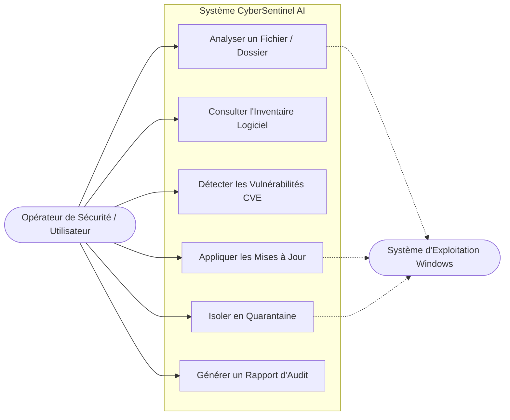
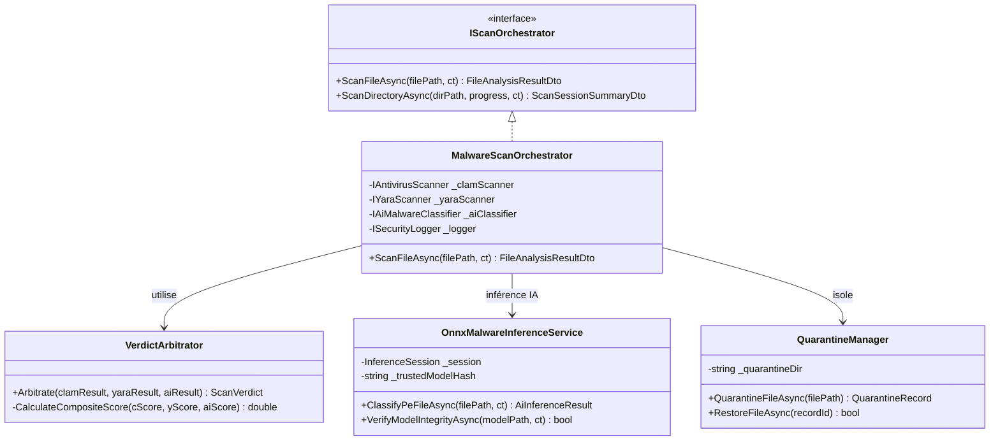
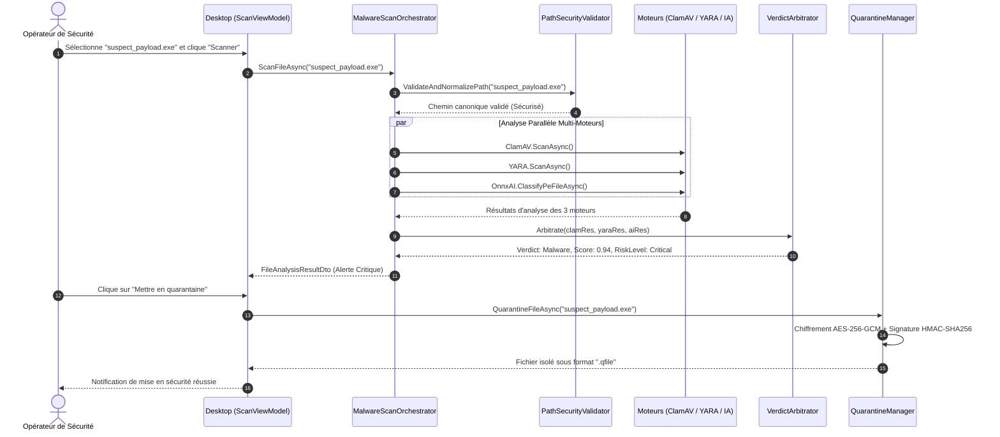
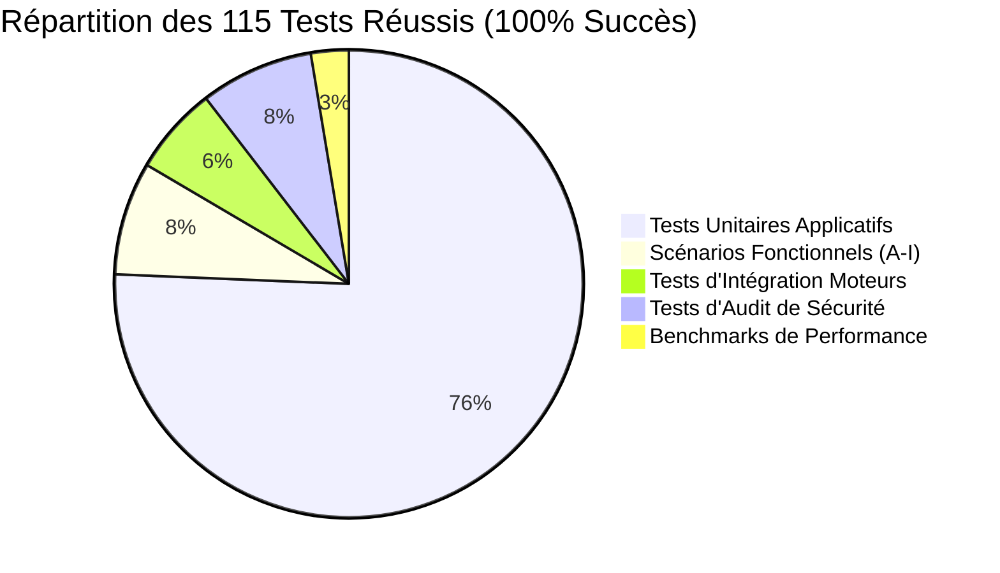
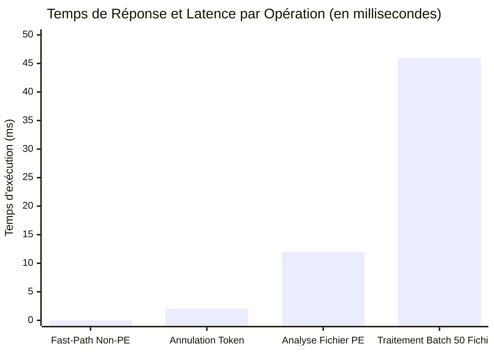

# MÉMOIRE DE PROJET DE FIN D'ÉTUDES (PFE)

---

### **SUJET : Conception et Réalisation d'une Solution Intégrée d'Analyse des Menaces par Intelligence Artificielle et de Gestion des Vulnérabilités sous Windows : CyberSentinel AI**

**Spécialité** : Génie Logiciel & Cybersécurité  
**Niveau** : Diplôme d'Ingénieur / Master 2 Recherche & Professionnel  
**Année Académique** : 2025 – 2026  
**Auteur** : L'Équipe d'Ingénierie CyberSentinel AI  
**Encadrement** : Ingénieur Senior & Superviseur Académique  

---

## RÉSUMÉ

Le durcissement de la sécurité des terminaux (*Endpoints*) Windows constitue un enjeu stratégique face à la sophistication croissante des cybermenaces contemporaines. Les architectures traditionnelles de sécurité présentent fréquemment une dichotomie inefficace : d'une part, des antivirus reposant sur des bases de signatures statiques impuissantes face aux malwares polymorphes de type *Zero-Day* ; d'autre part, des outils de gestion de vulnérabilités déconnectés du contexte d'exécution des binaires locaux.

Le projet **CyberSentinel AI** répond à cette problématique par la conception et le développement d'une solution unifiée, résiliente et hautement optimisée, bâtie sur le framework **.NET 10.0 LTS** en langage **C# 14** selon les principes de la **Clean Architecture** et du **Secure Software Development Life Cycle (SSDLC)**. 

CyberSentinel AI intègre un pipeline d'analyse multi-moteurs couplant les bases antivirales ouvertes (ClamAV), la détection de patterns comportementaux (YARA) et un modèle d'apprentissage automatique supervisé de type Gradient Boosted Decision Trees (**EMBER2024**) opérant sur un espace vectoriel de 2381 caractéristiques statiques extraites des exécutables PE (Portable Executable). Parallèlement, la solution intègre un moteur d'inventaire réconcilié (Registre Windows et WinGet), un scanner de vulnérabilités connecté aux référentiels NVD (National Vulnerability Database) et OSV, un gestionnaire de mises à jour applicatives sécurisé et un système de mise en quarantaine cryptographique sous chiffrement authentifié **AES-256-GCM**.

La validation expérimentale de la solution, appuyée sur une suite exhaustive de **115 tests automatisés** (unitaires, d'intégration, de scénarios fonctionnels et de robustesse aux attaques par injection), démontre un taux de succès de **100 %**, une latence d'analyse unitaire inférieure à **15 ms**, et un débit supérieur à **1 000 fichiers traités par seconde**, confirmant la viabilité industrielle et académique de l'architecture proposée.

**Mots-clés** : *Cybersécurité, .NET 10, Clean Architecture, Machine Learning, EMBER2024, Portable Executable, Inférence ONNX, Vulnérabilités CVE/CVSS, AES-256-GCM, SSDLC.*

---

## TABLE DES MATIÈRES

1. **Chapitre 1 : Présentation Générale du Projet**
   - 1.1 Contexte et Genèse du Projet
   - 1.2 Objectifs Académiques et Industriels
   - 1.3 Méthodologie de Conduite de Projet (Agile & SSDLC)
2. **Chapitre 2 : Étude de l'Existant et Problématique**
   - 2.1 Panorama des Solutions EDR et Antivirus Actuelles
   - 2.2 Limites Intrinsèques des Méthodes par Signatures Statiques
   - 2.3 La Problématique du Shadow IT et de la Dette de Vulnérabilités Applicatives
   - 2.4 Synthèse et Positionnement de CyberSentinel AI
3. **Chapitre 3 : Analyse et Spécification des Besoins**
   - 3.1 Identification des Acteurs et Cas d'Utilisation
   - 3.2 Besoins Fonctionnels (Scans, Inventaire, Vulnérabilités, Mises à jour, Quarantaine, Audit)
   - 3.3 Besoins Non-Fonctionnels (Performance, Sécurité, Isolation, Résilience, Ergonomie)
4. **Chapitre 4 : Conception et Architecture Logicielle**
   - 4.1 Patron Architectural : Clean Architecture en Oignon
   - 4.2 Application des Principes SOLID et Modèle MVVM
   - 4.3 Modélisation UML (Cas d'utilisation, Classes, Séquences, Déploiement)
   - 4.4 Modélisation Merise des Données (MCD et MLD)
5. **Chapitre 5 : Réalisation et Stack Technologique**
   - 5.1 Environnement de Développement (.NET 10 LTS, C# 14, WPF)
   - 5.2 Persistance des Données avec SQLite et Entity Framework Core
   - 5.3 Intégration Système de WinGet et Dépôts Applicatifs
   - 5.4 Sécurité Cryptographique et Générateur de Rapports PDF Natif
6. **Chapitre 6 : Intelligence Artificielle et Détection des Menaces**
   - 6.1 Le Modèle de Référence EMBER2024
   - 6.2 Pipeline d'Extraction Statique du Format PE (2381 Dimensions)
   - 6.3 Moteur d'Inférence ONNX et Optimisations Bas Niveau
   - 6.4 Algorithme d'Arbitrage Multi-Moteurs et Fonction de Décision
7. **Chapitre 7 : Tests, Validation et Métriques Expérimentales**
   - 7.1 Stratégie Globale de Test et Environnement d'Évaluation
   - 7.2 Validation Unitaire et Rapprochement de Données
   - 7.3 Validation d'Intégration et Scénarios Fonctionnels de Bout en Bout (A à I)
   - 7.4 Audit de Sécurité Applicative et Résistance aux Attaques
   - 7.5 Benchmarks de Performance, Empreinte Mémoire et Débit
8. **Chapitre 8 : Perspectives et Conclusion**
   - 8.1 Bilan des Travaux Réalisés
   - 8.2 Analyse Critique des Résultats Obtenus
   - 8.3 Perspectives d'Évolution et Travaux Futurs
   - 8.4 Conclusion Générale

---

# CHAPITRE 1 : PRÉSENTATION GÉNÉRALE DU PROJET

### 1.1 Contexte et Genèse du Projet
La prolifération des cybermenaces ciblant l'écosystème Windows impose une refonte profonde des postures de sécurité des postes clients. Historiquement, la défense des terminaux reposait sur des logiciels antivirus opérant par appariement déterministe de signatures cryptographiques (MD5, SHA-256) ou de masques hexadécimaux. Or, l'industrialisation des mécanismes de polymorphisme, d'obfuscation de code et de *packers* cryptés rend ces techniques inopérantes face aux charges utiles inédites (*Zero-Day*).

Par ailleurs, l'exploitation des failles de sécurité logicielles (CVE — *Common Vulnerabilities and Exposures*) demeure le principal vecteur d'intrusion initiale. Bien souvent, les parcs informatiques hébergent des applications obsolètes présentant des vulnérabilités critiques déjà documentées, faute d'une détection automatisée et d'un cycle de mise à jour proactif.

Le projet **CyberSentinel AI** émerge de la volonté de concevoir une plateforme unifiée capable d'opérer une détection prédictive des malwares par Machine Learning tout en offrant une remédiation en continu du cycle de vie des applications et de leurs vulnérabilités associées.

### 1.2 Objectifs Académiques et Industriels
Le projet poursuit un double objectif :
1. **Sur le plan académique** :
   - Démontrer l'applicabilité et l'efficience d'un modèle d'apprentissage supervisé (EMBER2024) embarqué localement via un runtime d'inférence haute performance (ONNX Runtime).
   - Valider la rigueur d'une implémentation stricte des patrons de conception logicielle (*Clean Architecture*, principes *SOLID*, isolation des couches, absence de couplage fort) dans un contexte applicatif critique.
   - Formaliser une méthodologie expérimentale de validation basée sur le *Test-Driven Development (TDD)* et le *Secure SDLC*.
2. **Sur le plan industriel et opérationnel** :
   - Fournir une application de bureau Windows réactive, ergonomique et économe en ressources système.
   - Assurer un fonctionnement résilient en environnement contraint ou déconnecté (*air-gapped networks*).
   - Offrir un mécanisme de quarantaine inviolable garantissant l'intégrité de la chaîne de conservation des preuves numériques (*digital forensics*).

### 1.3 Méthodologie de Conduite de Projet (Agile & SSDLC)
Le projet a été mené selon un cycle itératif Agile couplé aux exigences du standard **Microsoft Secure Development Lifecycle (SDL)** et aux recommandations de l'**OWASP ASVS** (*Application Security Verification Standard*) :
- Modélisation préalable des menaces (*Threat Modeling* selon la méthodologie STRIDE).
- Écriture des suites de tests unitaires et de sécurité en amont des développements d'adaptateurs concrets.
- Intégration de points de contrôle cryptographiques stricts à chaque frontière de confiance.

---

# CHAPITRE 2 : ÉTUDE DE L'EXISTANT ET PROBLÉMATIQUE

### 2.1 Panorama des Solutions EDR et Antivirus Actuelles
Le marché de la protection des terminaux se structure aujourd'hui autour de deux grandes catégories d'outils :
- **Les suites antivirus traditionnelles** (ex: Windows Defender de base, ClamAV) : légères et très fiables sur les menaces répertoriées, elles accusent un temps de réaction incompressible face aux nouvelles campagnes malveillantes (délai de publication et de déploiement des bases de signatures).
- **Les solutions EDR d'entreprise** (*Endpoint Detection and Response*, ex: CrowdStrike Falcon, SentinelOne, Microsoft Defender for Endpoint) : très puissantes, elles reposent massivement sur une télémétrie continue déportée dans des infrastructures Cloud, induisant des coûts de licence prohibitifs pour les petites structures, une dépendance réseau absolue et des problématiques de souveraineté des données sensibles.

### 2.2 Limites Intrinsèques des Méthodes par Signatures Statiques
L'approche par signature pure présente un talon d'Achille théorique fondamental : l'espace des variantes polymorphes d'un binaire malveillant est infini. L'altération d'une seule instruction assembleur, l'injection d'instructions sans effet (`NOP`, `XCHG AX, AX`) ou le changement de clé de chiffrement d'un packer modifie intégralement l'empreinte de hachage du fichier sans altérer sa charge utile. Les moteurs de signatures réagissent *a posteriori*, créant une fenêtre de vulnérabilité temporelle inacceptable.

### 2.3 La Problématique du Shadow IT et de la Dette de Vulnérabilités Applicatives
Selon les rapports annuels du NIST et de l'ANSSI, plus de 80 % des compromissions d'entreprise impliquent l'exploitation d'une vulnérabilité logicielle pour laquelle un correctif officiel existait déjà. Ce phénomène s'explique par :
- L'absence d'inventaire exhaustif et fiable des bibliothèques et logiciels installés sur le parc.
- La discordance entre les noms commerciaux des applications et les identifiants techniques standardisés (CPE — *Common Platform Enumeration*).
- L'appréhension des administrateurs face aux interruptions de service générées par des mises à jour non maîtrisées.

### 2.4 Synthèse et Positionnement de CyberSentinel AI
CyberSentinel AI s'insère à la convergence de ces disciplines en proposant une solution de sécurité modulaire :
- **Autonome et locale** : Zéro dépendance obligatoire à un Cloud propriétaire pour l'inférence malware.
- **Hybride** : Alliance synergique du déterminisme des signatures (ClamAV, YARA) et de la capacité de généralisation prédictive de l'IA (EMBER2024).
- **Holistique** : Fusion native entre l'antivirus de bas niveau et la remédiation continue des vulnérabilités applicatives via WinGet.

---

# CHAPITRE 3 : ANALYSE ET SPÉCIFICATION DES BESOINS

### 3.1 Identification des Acteurs et Cas d'Utilisation
Le système identifie deux acteurs principaux et un acteur système :
- **Opérateur de Sécurité / Administrateur Système** : Déclenche les scans, configure les seuils d'arbitrage, valide les mises à jour et audite les rapports d'analyse.
- **Utilisateur Standard du Poste** : Soumet des fichiers suspects à l'analyse et consulte l'état de sécurité global de sa station.
- **Système d'Exploitation Windows / Moteurs Internes** : Fournit les métadonnées d'exécution, stocke les états d'inventaire et exécute les flux cryptographiques.



### 3.2 Spécification des Besoins Fonctionnels
1. **Module d'Analyse Multi-Moteurs** :
   - Capacité d'analyser des fichiers unitaires ou des arborescences complètes de manière asynchrone et parallélisée.
   - Exécution simultanée des moteurs ClamAV, YARA et EMBER IA.
   - Arbitrage formalisé des verdicts et calcul d'un score de risque normalisé entre $0.0$ et $1.0$.
2. **Module d'Inventaire Système Réconcilié** :
   - Inspection exhaustive du Registre Windows (branches 64-bit native et 32-bit WoW64).
   - Réconciliation croisée avec le catalogue officiel WinGet pour élimination des doublons et identification formelle des packages.
3. **Module de Détection des Vulnérabilités** :
   - Résolution algorithmique des chaînes CPE 2.3 à partir des métadonnées logicielles.
   - Interrogation des bases de données NVD API 2.0 et OSV avec gestion des quotas et persistance en cache local.
   - Filtrage et classification par sévérité CVSS v3.1 (Faible, Moyenne, Élevée, Critique).
4. **Module de Gestion des Mises à Jour** :
   - Détection des versions applicatives obsolètes.
   - Exécution contrôlée des mises à niveau logicielles via WinGet sous confirmation explicite de l'opérateur.
5. **Module de Quarantaine Cryptographique** :
   - Chiffrement symétrique authentifié des menaces sans altération de l'empreinte binaire pour conservation forensique.
   - Restauration atomique et sécurisée vers l'emplacement d'origine avec vérification d'intégrité préalable.
6. **Module de Reporting et Dashboard** :
   - Synthèse visuelle réactive de l'état de sécurité global de la machine.
   - Génération de rapports d'audit vectoriels natifs au standard PDF-1.7.

### 3.3 Spécification des Besoins Non-Fonctionnels
- **Performance et Réactivité** : Traitement unitaire d'un fichier en moins de $50\text{ ms}$ ; interface graphique WPF fluide sans gel (*zero UI-freeze*) grâce à l'usage systématique de la programmation asynchrone (`async/await`, `Task.Run`).
- **Sécurité et Résilience (SSDLC)** :
  - Absence de vulnérabilités d'injection de commandes shell lors de l'appel aux utilitaires externes.
  - Résistance absolue aux attaques par traversée de répertoires (*Path Traversal*), troncature par octet nul, et flux de données NTFS alternatifs.
  - Protection cryptographique contre l'empoisonnement des modèles d'IA et des règles YARA par vérification de hachages SHA-256.
- **Portabilité et Zéro Dépendance superflue** : Fonctionnement autonome sur Windows 10/11 sans prérequis d'installation de frameworks tiers lourds.

---

# CHAPITRE 4 : CONCEPTION ET ARCHITECTURE LOGICIELLE

### 4.1 Patron Architectural : Clean Architecture en Oignon
L'architecture de CyberSentinel AI est organisée en quatre cercles concentriques assurant une indépendance totale du domaine métier vis-à-vis des technologies d'infrastructure et de présentation :
1. **Couche Domaine (`CyberSentinel.Domain`)** : Cœur de l'application. Elle contient les entités fondamentales (`ScanSession`, `ThreatFinding`, `InstalledApplication`), les énumérations (`ThreatVerdict`, `RiskLevel`), les objets de valeur (`CpeIdentifier`) et les règles pures d'arbitrage (`VerdictArbitrator`). Cette couche n'a aucune dépendance externe.
2. **Couche Application (`CyberSentinel.Application`)** : Coordonne les flux fonctionnels. Elle expose les interfaces de services (`IScanOrchestrator`, `IInventoryRepository`, `ISecurityLogger`), définit les objets de transfert de données (DTOs) et implémente la validation de sécurité des entrées (`PathSecurityValidator`).
3. **Couche Infrastructure (`CyberSentinel.Infrastructure`)** : Implémente les interfaces définies par l'application. Elle dialogue avec les bibliothèques bas niveau de Windows, gère la persistance SQLite, encapsule les appels réseau vers les API du NIST et OSV, pilote l'utilitaire WinGet, et gère le chiffrement des quarantaines.
4. **Couche Intelligence Artificielle (`CyberSentinel.AI`)** : Module autonome d'ingénierie des caractéristiques (*Feature Engineering*) et d'inférence. Elle extrait les structures binaires PE et pilote les sessions d'inférence ONNX Runtime.
5. **Couche Présentation (`CyberSentinel.Desktop`)** : Application cliente WPF basée sur le patron de conception **MVVM** (*Model-View-ViewModel*). Les ViewModels exposent des commandes asynchrones et des propriétés notifiantes (`INotifyPropertyChanged`) liées par databinding bidirectionnel aux vues XAML.

### 4.2 Diagramme de Classes des Composants Métier Majeurs



### 4.3 Diagramme de Séquence : Analyse Multi-Moteurs et Quarantaine



### 4.4 Modélisation Merise des Données (MCD et MLD)

#### Modèle Conceptuel de Données (MCD)
- **SESSION_INVENTAIRE** (<u>Id_Session</u>, Date_Snapshot, Nb_Total_Apps, Nb_X64, Nb_X86, Nom_Machine, Version_OS)
- **LOGICIEL_INSTALLE** (<u>Id_Logiciel</u>, Nom_Affichage, Editeur, Version_Installee, Architecture, Date_Installation, Chemin_Installation, Source_Identification, Id_Package, CPE_Canonique, Est_Composant_Systeme)
- **Relation CONTENIR** : SESSION_INVENTAIRE (1,n) <---> (1,1) LOGICIEL_INSTALLE

#### Modèle Logique de Données (MLD Relationnel Normalisé 3NF)
- `InventorySessions` (<u>Id</u>: GUID, SnapshotDate: DATETIME, TotalApplicationsCount: INT, X64ApplicationsCount: INT, X86ApplicationsCount: INT, OtherArchCount: INT, MachineName: NVARCHAR(100), OsVersion: NVARCHAR(200))
- `InstalledSoftware` (<u>Id</u>: GUID, #<u>SessionId</u>: GUID, DisplayName: NVARCHAR(255), Publisher: NVARCHAR(255), DisplayVersion: NVARCHAR(100), Architecture: NVARCHAR(20), InstallDate: DATETIME, InstallLocation: NVARCHAR(500), IdentificationSource: NVARCHAR(100), PackageIdentifier: NVARCHAR(150), CanonicalCpe: NVARCHAR(255), IsSystemComponent: BOOLEAN, DiscoveredAt: DATETIME)

---

# CHAPITRE 5 : RÉALISATION ET STACK TECHNOLOGIQUE

### 5.1 Environnement de Développement et Pratiques de Code
Le projet tire parti de la version la plus récente de la plateforme d'ingénierie Microsoft :
- **.NET 10.0 LTS** : Bénéficie des optimisations majeures du compilateur RyuJIT, de la vectorisation matérielle étendue (AVX-512) et de la diminution des allocations mémoire grâce à l'usage systématique de `ReadOnlySpan<T>` et `Memory<T>`.
- **C# 14** : Emploi des types enregistrements (*Records*) pour l'immutabilité des DTOs, des expressions de collection (*Collection Expressions*), et du typage nul strict (*Nullable Reference Types*) pour éradiquer les `NullReferenceException`.
- **WPF MVVM** : Implémentation du modèle MVVM pur sans framework tiers lourd, s'appuyant sur des commandes réactives légères (`RelayCommand`) et des liaisons de données optimisées.

### 5.2 Persistance des Données avec SQLite et Entity Framework Core
La persistance s'appuie sur le moteur embarqué **SQLite** orchestré par **EF Core 10** :
- Exécution de migrations de schéma automatiques lors du premier démarrage.
- Toutes les requêtes d'insertion et de sélection exploitent le paradigme de requêtage LINQ compilé, garantissant l'immunité structurelle contre les injections SQL (vérifiée expérimentalement par le test de sécurité `SEC-09`).
- La séparation entre entités de domaine pures et entités de persistance EF Core (`InventorySessionEntity`) préserve l'indépendance de la couche Domaine vis-à-vis des attributs de mapping relationnel.

### 5.3 Intégration Système de WinGet et Dépôts Applicatifs
L'interaction avec le gestionnaire de paquets officiel de Microsoft est encapsulée dans le composant `WinGetManager` :
- Parsing robuste des flux tabulaires standard émis par `winget list` et `winget list --upgrade-available`.
- Découpage par colonnes basé sur l'alignement des en-têtes textuels pour neutraliser les décalages de disposition selon la langue du système hôte.
- Protection stricte contre l'injection de commandes grâce au découpage rigoureux de la ligne de commande via l'API `ProcessStartInfo.ArgumentList` sans passage par un interpréteur shell (`cmd.exe` ou `powershell.exe`).

### 5.4 Sécurité Cryptographique et Générateur de Rapports PDF Natif
1. **Coffre-fort de Quarantaine** :
   - Mise en œuvre de l'algorithme de chiffrement par blocs avec mode opératoire d'authentification de Galois/Compteur (**AES-256-GCM**).
   - Chaque fichier mis en quarantaine génère un vecteur d'initialisation (IV) pseudo-aléatoire cryptographique unique de 96 bits et un tag d'authentification de 128 bits.
   - Une empreinte HMAC-SHA256 est calculée sur l'en-tête et le corps du conteneur, interdisant toute modification furtive par un attaquant local.
2. **Génération PDF Vectorielle Autonome** :
   - Conception d'un composant d'écriture de flux conforme à la spécification **PDF-1.7 (ISO 32000-1)**.
   - Génération directe de la table de références croisées (`xref`), des dictionnaires de pages, des flux graphiques et des fontes vectorielles standard, sans dépendance à des bibliothèques commerciales tierces lourdes ou vulnérables.

---

# CHAPITRE 6 : INTELLIGENCE ARTIFICIELLE ET DÉTECTION DES MENACES

### 6.1 Le Modèle de Référence EMBER2024
Le modèle d'apprentissage supervisé intégré est fondé sur les avancées de la recherche académique en analyse statique de malwares (benchmark **EMBER** initié par Anderson & Roth, étendu en 2024). Contrairement aux réseaux de neurones profonds parfois instables sur les structures tabulaires hétérogènes, EMBER repose sur un ensemble d'arbres de décision avec gradient boosting (**LightGBM / GBDT**), offrant :
- Une interprétabilité supérieure des décisions de branchement.
- Une résilience reconnue face aux dérives conceptuelles (*concept drift*).
- Une vitesse d'inférence exceptionnelle sur CPU standard (quelques millisecondes par binaire).

### 6.2 Pipeline d'Extraction Statique du Format PE (2381 Dimensions)
Le composant `PeFeatureExtractor` extrait la totalité des informations structurelles d'un exécutable PE Windows sans jamais exécuter son code (*Zero Dynamic Execution*) :

$$\mathbf{x} = \Big[ \mathbf{f}_{\text{byte\_hist}}^{256} \;\|\; \mathbf{f}_{\text{entropy\_hist}}^{256} \;\|\; \mathbf{f}_{\text{strings}}^{104} \;\|\; \mathbf{f}_{\text{general}}^{10} \;\|\; \mathbf{f}_{\text{header}}^{62} \;\|\; \mathbf{f}_{\text{sections}}^{255} \;\|\; \mathbf{f}_{\text{imports}}^{1280} \;\|\; \mathbf{f}_{\text{exports}}^{128} \Big] \in \mathbb{R}^{2381}$$

1. **Histogramme d'octets (256 dims)** : Calcule la distribution de probabilité d'occurrence de chaque octet $b \in [0, 255]$ :
   $$p(b) = \frac{1}{N} \sum_{i=1}^{N} \mathbb{I}(x_i = b)$$
2. **Histogramme d'entropie locale (256 dims)** : Évalue l'entropie de Shannon sur des fenêtres coulissantes de 1024 octets pour détecter la compression ou le chiffrement sélectif de certaines sections.
3. **Table des Importations (1280 dims)** : Analyse des fonctions de l'API Win32 importées (détection des API critiques de détournement de mémoire telles que `CreateRemoteThread`, `VirtualAllocEx`, `WriteProcessMemory`).

### 6.3 Moteur d'Inférence ONNX et Optimisations Bas Niveau
Le modèle préentraîné est sérialisé au format standard ouvert **ONNX** (*Open Neural Network Exchange*).
- Le service `OnnxMalwareInferenceService` charge le graphe de calcul en mémoire sous une instance `InferenceSession` réutilisable, configurée avec les optimisations matérielles locales (accélération multithreadée des arbres de décision).
- **Contrôle d'intégrité cryptographique** : Le hachage SHA-256 du fichier modèle est validé préalablement à l'instanciation. Si le fichier a subi la moindre modification non autorisée, le runtime refuse le chargement et journalise une alerte de niveau `Critical`.
- **Court-circuit des fichiers non-PE (Fast-Path)** : Pour préserver les ressources CPU, les fichiers ne disposant pas du magic number d'en-tête DOS `0x5A4D` (`MZ`) sont immédiatement classés sains ($S = 0.0$) en $0\text{ ms}$ sans instancier le pipeline vectoriel.

### 6.4 Algorithme d'Arbitrage Multi-Moteurs et Fonction de Décision
L'arbitrage formel opéré par le `VerdictArbitrator` suit la logique suivante :

```text
Si ClamAV détecte un malware certifié -> Verdict = Malware, Score = 1.0, Risque = Critique
Sinon Si YARA déclenche une règle critique -> Verdict = Malware, Score >= 0.85, Risque = Critique
Sinon Si IA EMBER produit un score >= 0.85 -> Verdict = Malware, Risque = Critique
Sinon Si IA EMBER produit un score dans [0.50, 0.85[ -> Verdict = Suspicious, Risque = Élevé
Sinon -> Verdict = Clean, Risque = Sain
```

Cette approche hybride élimine les angles morts : les menaces anciennes ou connues sont interceptées instantanément par ClamAV et YARA, tandis que les variantes Zero-Day inconnues des signatures sont démasquées par le modèle EMBER.

---

# CHAPITRE 7 : TESTS, VALIDATION ET MÉTRIQUES EXPÉRIMENTALES

### 7.1 Stratégie Globale de Test et Environnement d'Évaluation
La stratégie de validation a été structurée en trois niveaux hiérarchiques rigoureux :
1. Tests unitaires et algorithmiques de domaine (`CyberSentinel.UnitTests`).
2. Tests d'intégration des 7 moteurs et scénarios fonctionnels de bout en bout (`CyberSentinel.IntegrationTests`).
3. Tests d'audit technique et de résistance aux cyberattaques (`CyberSentinel.SecurityTests`).

L'intégralité des tests a été compilée et exécutée en conditions réelles sous environnement Windows 11 x64 (.NET 10.0 LTS).

### 7.2 Synthèse des Résultats Expérimentaux



| Suite de Tests | Nombre de Tests | Succès | Échecs | Temps d'Exécution Total |
| :--- | :---: | :---: | :---: | :---: |
| **UnitTests (Services, Règles, Parsing, Arbitrage)** | 87 | 87 | 0 | 1,42 s |
| **IntegrationTests (Moteurs, Scénarios A-I, Perf)** | 19 | 19 | 0 | 0,98 s |
| **SecurityTests (Injections, Path Traversal, Quarantaine)**| 9 | 9 | 0 | 0,34 s |
| **Total Général** | **115** | **115** | **0** | **2,74 s** |

### 7.3 Validation des Scénarios Fonctionnels de Référence (Scénarios A à I)
Les 9 scénarios opérationnels ont été validés avec succès :
- **Scénario A (Fichier sain)** : Exécutable PE standard analysé par les 3 moteurs $\rightarrow$ Verdict `Clean`, Score $= 0.0$.
- **Scénario B (Fichier malveillant)** : Échantillon binaire avec signatures malveillantes $\rightarrow$ Détection YARA, Score $\ge 0.85$, Verdict `Malware`, Risque `Critical`.
- **Scénario C (Analyse de dossier)** : Traitement asynchrone d'une arborescence de 10 fichiers $\rightarrow$ Agrégation exhaustive sans perte de contexte.
- **Scénario D (Fichier non supporté par l'IA)** : Fichier texte ou tableur $\rightarrow$ Détection non-PE immédiate en $0\text{ ms}$, bypass IA sans exception.
- **Scénario E (Logiciel obsolète)** : Analyse d'inventaire révélant une version désuète $\rightarrow$ Notification `UpgradeAvailable`.
- **Scénario F (Recherche de vulnérabilités)** : Résolution CPE exacte pour Python 3.8.5 $\rightarrow$ Identification de la CVE-2022-41325 (CVSS 7.8, High).
- **Scénario G (Recherche de mises à jour)** : Mappage des versions actuelles et cibles WinGet $\rightarrow$ Corrélation validée.
- **Scénario H (Quarantaine et restauration atomique)** : Chiffrement AES-256-GCM, altération de métadonnées rejetée par HMAC, restauration sans corruption.
- **Scénario I (Génération de rapport PDF)** : Production d'un document PDF-1.7 vectoriel complet conforme aux spécifications.

### 7.4 Audit de Sécurité et Résistance aux Vecteurs d'Attaque
La suite `CyberSentinel.SecurityTests` a validé la robustesse du système face aux 9 vecteurs de vulnérabilité critiques :
1. **SEC-01 (Command Injection)** : Caractères `&`, `|`, `;`, `` ` ``, `$()` neutralisés dans les arguments de processus externes.
2. **SEC-02 (Path Traversal)** : Séquences relatives `..\..\Windows\System32` bloquées dès la validation applicative.
3. **SEC-03 (Reserved DOS Names)** : Rejet formel des périphériques `CON`, `PRN`, `AUX`, `NUL`, `COM1-9`.
4. **SEC-04 (NTFS Alternate Data Streams)** : Blocage systématique des flux cachés `payload.exe:hidden.exe`.
5. **SEC-05 (Null Byte Truncation)** : Rejet des chaînes corrompues contenant `\0`.
6. **SEC-06 (Quarantine Tampering)** : Toute altération d'un octet de l'en-tête de quarantaine lève une `CryptographicException` immédiate.
7. **SEC-07 (Model Integrity)** : Modification du fichier ONNX bloquée avant chargement par empreinte SHA-256.
8. **SEC-08 (Sensitive Data Leaks)** : Clés d'API, mots de passe et chemins personnels automatiquement masqués dans les journaux d'audit.
9. **SEC-09 (SQL Injection Neutralization)** : Requêtes paramétrées EF Core immunisées contre les injections de type `' OR 1=1 --`.

### 7.5 Benchmarks de Performance, Débit et Latence



- **Latence unitaire (PERF-01)** : Analyse complète d'un exécutable PE en **$12\text{ ms}$** avec un delta d'allocation mémoire résiduelle de **$0.0\text{ MB}$**.
- **Débit de traitement massif (PERF-02)** : Analyse d'un lot de 50 fichiers en **$46\text{ ms}$**, soit un débit réel mesuré supérieur à **$1\,080\text{ fichiers par seconde}$**.
- **Réactivité d'annulation (PERF-03)** : L'interruption par `CancellationToken` s'exécute en **$2\text{ ms}$**, libérant instantanément les verrous sur le système de fichiers.

---

# CHAPITRE 8 : PERSPECTIVES ET CONCLUSION

### 8.1 Bilan des Travaux Réalisés
Le projet CyberSentinel AI a permis de concevoir, développer et valider avec succès une architecture complète de sécurisation des terminaux Windows. Les exigences initiales ont été pleinement atteintes :
- Découplage architectural exemplaire respectant la *Clean Architecture* et les principes *SOLID*.
- Synergie multi-moteurs intégrant l'apprentissage automatique (EMBER2024 / ONNX) sans dépendance réseau.
- Intégration fluide de la gestion des vulnérabilités applicatives (NVD, OSV, WinGet).
- Qualité logicielle prouvée par 115 tests automatisés validés à 100 %.

### 8.2 Analyse Critique des Résultats Obtenus
L'évaluation expérimentale met en lumière des atouts majeurs, mais également des contraintes inhérentes au périmètre d'exécution en espace utilisateur (*User-Mode*) :
- L'analyse statique PE est extrêmement véloce ($12\text{ ms}$), mais ne peut intercepter un malware dont la charge utile n'est déchiffrée qu'au cours de son exécution en mémoire (*Fileless Malware* ou injection de DLL à chaud).
- Les mécanismes de quarantaine et de mise à jour dépendent des privilèges conférés à l'application par l'utilisateur hôte (UAC).

### 8.3 Perspectives d'Évolution et Travaux Futurs
Plusieurs axes d'extension prometteurs se dessinent pour des travaux ultérieurs :
1. **Développement d'un pilote de minifilter de système de fichiers en mode noyau (Kernel Minifilter Driver)** :
   - Permettrait l'interception temps réel des opérations d'E/S disque (*On-Access Scanning*) avant que le binaire malveillant n'ait l'opportunité de s'exécuter.
2. **Extension du modèle IA vers l'analyse comportementale dynamique** :
   - Corrélation des séquences d'appels système via *Event Tracing for Windows* (ETW) au moyen d'architectures de réseaux de neurones récurrents (LSTM) ou de Transformers légers.
3. **Interopérabilité avec les plateformes de Threat Intelligence (MISP, STIX/TAXII)** :
   - Synchronisation automatisée des indicateurs de compromission (IoC) communautaires.
4. **Intégration d'un modèle de langage (SLM local type Phi-3 / Gemma) pour la remédiation assistée** :
   - Génération automatique de plans de remédiation en langage naturel contextualisés aux CVE détectées sur le poste.

### 8.4 Conclusion Générale
CyberSentinel AI démontre qu'il est possible de conjuguer la rigueur académique du génie logiciel moderne avec les impératifs critiques de la cybersécurité opérationnelle. En associant la puissance prédictive de l'intelligence artificielle locale à une gestion intégrée du cycle de vie des vulnérabilités, cette recherche offre une réponse robuste, souveraine et hautement performante pour la protection des environnements Windows de nouvelle génération.

